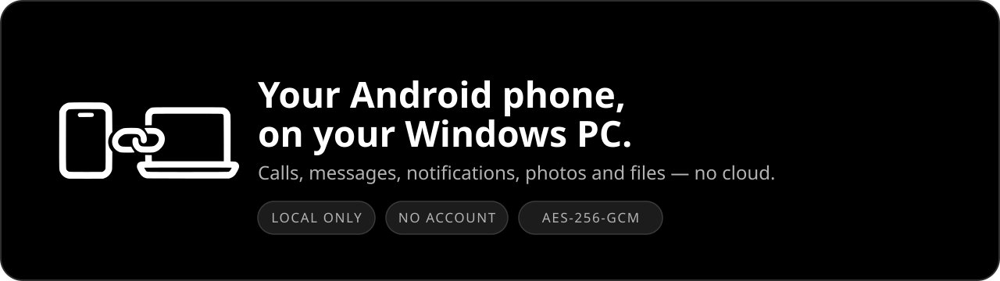
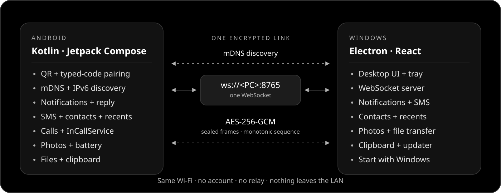

<h1 align="center">LinkPhone</h1>

<p align="center">
  
</p>

<p align="center">
  <a href="https://github.com/FakeAbid11/linkphone/releases/latest"></a>
  <a href="https://github.com/FakeAbid11/linkphone/actions/workflows/ci.yml"></a>
  <a href="LICENSE"></a>
  
  
  
</p>

<p align="center">
  <a href="https://github.com/FakeAbid11/linkphone/releases/latest"><strong>Download the latest release →</strong></a>
</p>

<p align="center">
  <a href="#features">Features</a> ·
  <a href="#architecture">Architecture</a> ·
  <a href="#install">Install</a> ·
  <a href="#security">Security</a> ·
  <a href="#roadmap">Roadmap</a> ·
  <a href="#development">Development</a>
</p>

LinkPhone puts your Android phone on your Windows PC over your own Wi-Fi. Pair once with a QR
code, then handle calls, texts, notifications, photos and files without an account, a cloud
service or a relay server.

**No account. No cloud. No relay.**

> **v0.1.4** makes camera access a one-time grant: Android asks once, the card explains choosing
> “While using the app” instead of “Only this time”, and a revoked grant stops the stream cleanly
> instead of freezing it.

## Features

| Feature | Status | Detail |
|---|---|---|
| Pairing and discovery | Yes | QR or 8-character code; mDNS, with an IPv6 link-local fallback |
| Android onboarding | Yes | Three first-launch screens: how it works, permissions and pairing |
| Notification mirroring | Yes | Live progress, group and ongoing alerts, search, history, mute/clear, actions and reliable inline reply |
| SMS | Partial | New or existing conversations with contact suggestions, search and retry failed sends; no MMS |
| Dual SIM | Yes | Pick the SMS SIM and call SIM from the PC; labels on messages, calls and history |
| Contacts and call history | Yes | Recent calls and contacts share a switch beside the dialer |
| Phone calls | Partial | Dial, answer, hang up, mute and use the phone speaker from the PC (best effort); SIM and VoIP calls (WhatsApp, Telegram, Messenger, Instagram) controllable; audio stays on the phone |
| Find my phone | Yes | Ring the connected phone for 5–30 s and stop it from the phone or the PC |
| Media controls | Yes | Album art, seek and phone volume plus play/pause and next/previous |
| Photo albums | Yes | Thumbnails, paged albums, previews, downloads, uploads and inline video playback |
| Phone downloads | Yes | Browse accessible Downloads and pull files from the PC |
| Battery | Yes | Live percentage and charging state |
| Background | Yes | Foreground service with boot start; optional battery-optimization exemption |
| File transfer | Yes | Both directions, resumable and cancellable; Send to, drag and drop, or Share → LinkPhone |
| Clipboard | Yes | Text only, both ways; foreground by default, optional accessibility mode for background copies |
| Start with Windows | Yes | Opt-in hidden tray start, listed in Windows Startup Apps |
| Auto-reconnect | Yes | Reclaims a paired PC after reboot, app restart or a PC address change |
| Built-in updates | Yes | Automatic checks + notifications; verified Windows/Android installers |
| Screen mirroring | Not yet | Planned; `MediaProjection` + WebRTC |
| Camera | Yes | Live phone camera in the Camera tab, 720p/480p and front/back; share the LinkPhone window in meeting apps. Not a system webcam; no audio |
| App streaming | Not yet | Planned |

## Architecture

<p align="center">
  
</p>

One encrypted WebSocket carries control, messages, calls and 64 KiB file chunks. The phone finds
the PC over mDNS; the QR code also embeds IPv4 and link-local IPv6 addresses for networks that block
discovery. See [docs/PROTOCOL.md](docs/PROTOCOL.md) for the handshake, frames and threat model.

## Install

1. Open the [latest GitHub Release](https://github.com/FakeAbid11/linkphone/releases/latest).
2. **Phone:** install `linkphone-android.apk` (allow “install unknown apps”). A fresh install opens
   a three-step intro: what LinkPhone is, why each permission is needed, and pairing. You can skip
   it and set everything up later on the main screen.
3. **PC:** run `LinkPhone.Setup.0.1.4.exe`. The installer is unsigned, so SmartScreen requires
   **More info → Run anyway**. It also adds **Send to → LinkPhone** to Explorer; Windows 11 may keep
   it under **Show more options**.
4. **Pair:** on the PC, expand **Scan QR code instead** in the sidebar. On the phone, tap **Scan QR**
   (on the third intro screen or later under **Find your PC**) and point the camera at the PC.
5. **Grant phone permissions:** notification access for mirroring, SMS for messages, photos for the
   gallery, and contacts + call logs for the contacts hub.
6. **Calls:** allow **call access** on the phone. Notification access lets the PC see the live call
   card; no default-phone role is required.
7. Put both devices on the same Wi-Fi. mDNS and client-to-client traffic must be allowed;
   guest/AP-isolated networks will not work.

<details>
<summary><strong>Upgrading from an earlier build and SmartScreen notes</strong></summary>

If an earlier LinkPhone build is installed on the phone, uninstall it before installing this APK,
then pair again. Updates from 0.1.x onward install in place.

0.1.1 requires both apps on 0.1.1 or newer: a 0.1.1 phone refuses a 0.1.0 PC with an on-screen
message instead of connecting. Update the PC first, then the phone.

If the App update card shows "GitHub update check failed (403)", download the APK from the
[Releases page](https://github.com/FakeAbid11/linkphone/releases) and install it manually once.
0.1.2 and later read the public Releases page, so the check no longer depends on GitHub's
rate-limited API.

The Windows installer and Android APK are unsigned at the platform level: SmartScreen needs
**More info → Run anyway**, and Android always shows its own installer confirmation. Android may
first ask permission for LinkPhone to install updates.

</details>

<details>
<summary><strong>Phone camera on the PC</strong></summary>

Open **Camera** while LinkPhone is open on the phone and press **Start**. The phone streams 720p
(or 480p) video over the encrypted link at about 15 fps; front/back and quality can be changed
live. In Zoom, Meet, Teams or Discord choose **Share window → LinkPhone**. This is not a system
camera device — those apps will not list a new camera — and there is no audio. Keep the LinkPhone
window open: minimizing it, leaving the Camera tab, disconnecting or quitting stops the stream.
Android shows an ongoing notification with **Stop** while the camera runs, and the phone must be
unlocked with LinkPhone visible to start it. Android asks for camera access once: choose
**While using the app**. **Only this time** is switched off as soon as LinkPhone goes to the
background or the screen locks, which stops the stream; the card then offers Allow again, and if
Android will no longer prompt it offers **Open settings** instead.

</details>

<details>
<summary><strong>Permissions in detail</strong></summary>

- **Notification access** lets the PC show and reply to phone notifications. It is optional.
- **SMS** reads existing conversations and sends replies; LinkPhone does not become the default SMS
  app and does not create new threads. Android 10+ asks you to approve every text sent from the PC:
  that dialog is the system's per-message confirmation for apps that are not the default SMS app,
  not a LinkPhone permission request, and LinkPhone does not bypass it.
- **Camera** powers the QR scanner and the optional Camera tab. It is used only while you start a
  stream, and Android keeps a notification visible until it stops. Grant it with **While using the
  app** so Android does not ask again; **Only this time** ends when LinkPhone backgrounds.
- **Photos** uses Android's photo picker permissions; Android 14+ can expose all photos or a
  selected set.
- **Contacts** (`READ_CONTACTS`) resolves names and powers the searchable contact list.
- **Call logs** (`READ_CALL_LOG`) powers recent calls. It is optional and read-only, and Google Play
  restricts it — which is why LinkPhone is distributed as a sideloaded APK.
- **Default phone app** is required for reliable incoming and active call control. Restore your
  previous dialer at any time in Android Settings → Apps → Default apps → Phone app.

All permissions are optional at the OS level; features that need one explain themselves when it is
missing.

</details>

### Feature notes

<details>
<summary><strong>Phone calls stay on the phone</strong></summary>

LinkPhone dials from Windows with **call access** and controls the call without being the default
phone app. The phone includes a minimal dial/incoming/in-call screen and call notification, so calls
remain usable when Windows is offline.

The PC call card comes from two sources: the system dialer’s call notification when available, and
the phone’s own call state (`PhoneStateListener`). The second source appears even when the dialer
notification is hidden from notification listeners; in that case the caller may show as “Phone
call” or “Incoming call”. **Answer** uses `acceptRingingCall`, **Decline/Hang up** uses `endCall`,
and **Phone speaker** asks Android to route communication audio to the speaker. These are
best-effort: some phones or OEM dialers may block the deprecated Telecom calls or ignore speaker
routing. If a control fails, the PC shows the error and the call stays controllable on the phone.
With notification access off, the card still appears from call state; with phone-state access off,
the PC keeps the “Call sent to your phone” confirmation. Microphone and call audio never cross the
network. Do not depend on LinkPhone for emergency calling; use the phone's emergency interface
directly.

The card shows the number you dialed and `Dialing…` until the call connects, then `Connected` and a
talk timer. The timer is kept by the PC (not the phone’s clock), so its length is unaffected by clock
drift; without the default-phone role Android cannot report the exact answer instant, so the switch
to `Connected` follows the dialer’s running call timer and can lag by about a second.

</details>

<details>
<summary><strong>Contacts and call history</strong></summary>

Open **Calls** to see **Recent calls** beside the dialer, showing direction, time and duration with a
call-back button. Use the **Recent / Contacts** switch above the list to search the phone book and
call or message any number instead. Granting or revoking contact access reloads the list
immediately. Messaging opens an existing SMS thread only; a number without a
thread shows a hint. Both lists are read-only and pulled on demand over the encrypted link.

</details>

<details>
<summary><strong>Dual SIM</strong></summary>

When the phone has more than one SIM, Messages and Calls show a SIM picker. Sending uses the phone
default unless you choose another SIM. The phone needs **Phone access** to list SIMs; without it,
texts and calls keep using the default SIM and labels may be missing. Calls use Android's call
accounts, so eSIM profiles and carrier labels follow what the phone reports.

</details>

<details>
<summary><strong>Send files from Explorer</strong></summary>

Right-click one or more files → **Send to → LinkPhone**, or drag them onto the LinkPhone window. The
app opens the Files tab and sends them. If the phone is not connected, the files wait in memory and
are sent when it connects; quitting LinkPhone discards them. Folders are not supported. On the phone,
**Send file** stays disabled until the phone is connected, and **Forget** asks before removing the
pairing.

</details>

<details>
<summary><strong>Notification center</strong></summary>

Search notifications by app, title or text, and switch between **Newest** and **By app** views.
By-app headers show a count plus **Clear** and **Mute**: Clear removes that app's current cards and
dismisses them from the phone shade, while Mute also hides future notifications and Windows toasts.
Unmute an app from the **Muted** chips; muted settings persist on this PC. The single **Dismiss** and
Windows toast click also dismiss the notification on the phone. **History** keeps a searchable local
log of received notifications even after they are dismissed; clear it from the same panel.

A **Now playing** card appears when the phone has an active media session: play/pause and
next/previous work without opening the phone. It requires notification access.

Find-my-phone is the speaker icon on a connected phone card in the sidebar; it rings for about 15
seconds and respects the phone's silent/DND mode. Ongoing or system-locked notifications may refuse
dismissal on the phone; the PC card still hides. Live progress, quick actions, opening and inline
reply work in both views.

</details>

<details>
<summary><strong>Built-in updates</strong></summary>

The first install is manual. After that:

- **Windows:** LinkPhone checks about 20 seconds after launch, every six hours, and after sleep;
  a notification appears when a newer version is available. Choose **Download**, then
  **Restart & install** in Settings: LinkPhone closes, the update installs silently, and the app
  relaunches. A downloaded update no longer installs automatically when you quit LinkPhone.
- **Android:** a background check runs about every six hours even when LinkPhone is closed, and the
  App update card checks when the app opens. A notification appears when a newer version is
  available; choose **Download**, then **Install**. Android always shows its system installer
  confirmation. OEM battery managers may delay the background check; opening the app always checks.
  The check reads the public Releases page, not the rate-limited API, and a failed check backs off
  before retrying.
- Neither platform downloads or installs anything without you choosing it.
- Android downloads are verified against the published SHA-256 checksum
  (`linkphone-android.apk.sha256`) and the certificate that signed the installed LinkPhone app
  before the installer opens.

</details>

<details>
<summary><strong>Background on Android</strong></summary>

LinkPhone runs a foreground service so notifications, texts, calls, clipboard and the file socket
keep working while the app is in the background. It is a `connectedDevice` service, which Android 15
does not subject to the six-hour `dataSync` limit.

- **Boot start:** after a reboot the service starts automatically only if a phone is already
  paired; an unpaired install shows no service or notification. Opening LinkPhone also starts the
  service and reconnects without tapping **Reconnect**.
- **Auto reconnect:** a paired phone retries every saved QR address, then rediscovers the same PC
  over mDNS by its server ID if the PC's address changed. If either side's pairing data is deleted
  or the app is reinstalled, scan a fresh QR; reconnect never bypasses the saved key.
- **Battery optimization:** an in-app **Background connection** card asks Android for an exemption.
  Accepting it reduces Doze network throttling; you can undo it in system battery settings. The
  optional exemption uses the `REQUEST_IGNORE_BATTERY_OPTIMIZATIONS` permission, which Google Play
  restricts — LinkPhone ships as a sideloaded APK, and the app falls back to the standard
  battery-optimization list when a ROM does not show the direct dialog.
- **Xiaomi/HyperOS, Huawei:** enable Autostart for LinkPhone and set Battery saver to
  **No restrictions**; otherwise the system may block the boot receiver or kill the service.
- **Limits:** force-stopping LinkPhone from system settings stops it until you open it again.
  Clipboard phone→PC works while LinkPhone is open. To sync copies made in other apps, enable the
  optional clipboard accessibility service from the **Sync copies from other apps** card. It reads
  clipboard text only, never screen content; Android may show a clipboard-access notice.

</details>

<details>
<summary><strong>Theme and Start with Windows</strong></summary>

Both apps use a strictly monochrome, dark-only Material 3 theme: `#000000` background, `#121212`
cards, `#1C1C1C` elevated components, white primary text, `#B3B3B3` secondary text, and white/gray
Material Symbols Rounded icons. There is no light theme and no colorful accent. Android
notifications use a simplified phone + link mark with a gray accent so it stays legible at 24 dp.

**Start with Windows** is off by default in **Settings**. Enabling it registers a per-user login item,
so LinkPhone appears in **Windows Settings → Apps → Startup** and starts hidden in the tray. Disable
it from either LinkPhone or Windows; LinkPhone will not re-enable it.

</details>

### Troubleshooting

<details>
<summary><strong>Discovery finds nothing</strong></summary>

QR pairing embeds every IPv4 address reported by the PC and tries them in private-network order, so
it also works when mDNS is blocked. Client-to-client traffic and TCP port 8765 must still be allowed.
Guest Wi-Fi and AP isolation block device-to-device traffic entirely.

</details>

<details>
<summary><strong>Pairing no longer works after a reinstall or forget</strong></summary>

Scanning a fresh QR sends an explicit pairing intent. The PC runs the pairing
handshake even for a phone it already knows and replaces the old key once the new code proves valid.
If a connection still fails, click the **×** on the phone card in the PC sidebar and tap **Forget**
on the phone, then pair again.

</details>

<details>
<summary><strong>Wi-Fi isolates IPv4 clients</strong></summary>

The QR also embeds the PC's link-local IPv6 address, tried after the IPv4 addresses, so
pairing can work without a router change. USB tethering and the phone hotspot remain fallbacks for
networks that block both families.

</details>

<details>
<summary><strong>Notification actions or open do nothing</strong></summary>

The phone's OEM may block background activity starts. On HyperOS, allow LinkPhone to autostart and
to display pop-up windows while running in the background; then retry the action. Inline reply still
works without those permissions.

</details>

## Security

- No account, no cloud, no telemetry. Traffic never leaves the LAN.
- The handshake proves knowledge of the pairing code; every frame is AES-256-GCM with a monotonic
  sequence number and direction-bound AAD.
- SMS, contacts, call history and photo previews use the same encrypted channel and are never
  uploaded. Gallery previews live only in PC memory; originals are saved only when you choose
  **Download original**.
- Clipboard background sync is opt-in. Its accessibility service reads clipboard text only (never
  screen content), only while paired, and only sends to your PC over the encrypted channel.
- The PC stores the per-device key in `%APPDATA%\LinkPhone`; the phone stores it in
  `EncryptedSharedPreferences`.
- Updater checks contact only this repository's public GitHub Releases API. They send no phone data,
  account information or telemetry.

> **Not yet hardened:** there is no TLS/pinning and 6-digit pairing codes are accepted. Pairing
> attempts are rate-limited per IP, but a malicious host on your LAN could still impersonate the PC.
> Do not use LinkPhone on a network you do not trust.

## Roadmap

1. **MMS** — existing and new SMS conversations are supported; MMS needs the default-SMS-app role
   and an MMS pipeline, which LinkPhone does not claim.
2. **Screen mirroring** — `MediaProjection` → hardware H.264 encoder → WebRTC; touch injection via an
   `AccessibilityService`.
3. **TLS + certificate pinning**, manual IP entry, multi-device support.

<details>
<summary><strong>Why iOS is out of scope</strong></summary>

iOS exposes no SMS API, no notification access except ANCS over BLE, no screen capture of other apps
and no call control. An iPhone client could only mirror notifications and make calls over Bluetooth.
Android-first is the only way to reach feature parity.

</details>

## Development

Everything is built and tested by GitHub Actions; there are no local build steps for normal use.

| Path | Contents |
|---|---|
| `desktop/` | Electron + React + TypeScript PC app, WebSocket server, tray |
| `android/` | Kotlin + Jetpack Compose phone app, notification listener, InCallService |
| `docs/PROTOCOL.md` | Wire format, crypto and threat model |
| `docs/TESTING.md` | Manual test checklist |

```bash
cd desktop
npm install          # npm 12 asks before running electron's postinstall script
npm run dev          # Electron + Vite with HMR
```

Android needs Android Studio or the SDK plus JDK 17; run `gradle :app:installDebug` from `android/`.

## License

MIT — see [LICENSE](LICENSE).

<p align="center"><sub>Not affiliated with Microsoft. Built with Kotlin, Electron and an encrypted WebSocket.</sub></p>
